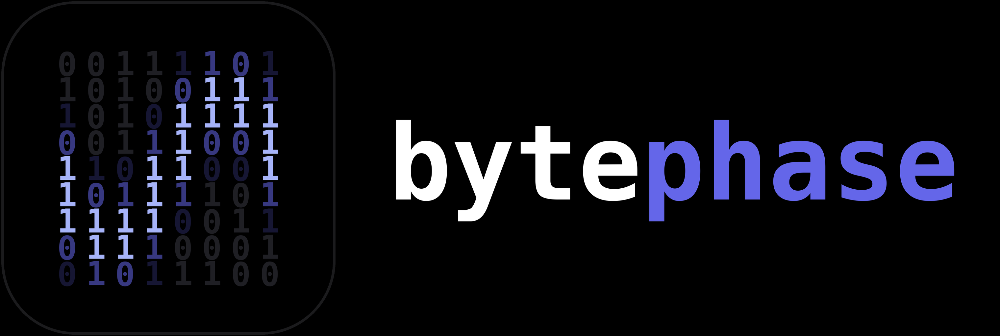

<div align="center">
  
  <h1>Bytephase</h1>
  <p><strong>Explore farther. Keep your bearings. Make the everyday easier.</strong></p>
  <p>A Fabric utility client for Minecraft 1.21.11.</p>
  <p><strong>0.2.4</strong> &nbsp;·&nbsp; Minecraft <strong>1.21.11</strong> &nbsp;·&nbsp; Fabric</p>
  <p>
    <a href="#features">Features</a> &nbsp;·&nbsp;
    <a href="#install">Install</a> &nbsp;·&nbsp;
    <a href="#build">Build</a> &nbsp;·&nbsp;
    <a href="docs/MODULE_GUIDE.md">Module guide</a>
  </p>
</div>

---

## Features

Bytephase includes **211 modules**, a searchable ClickGUI, configurable HUD
layouts, profiles, discovery tools, visual effects and combat utilities.

| Area | Features |
| --- | --- |
| Discovery | BaseFinder, SusChunks, MotionScanner, PrimeChunkFinder and SpawnerFinder |
| Navigation | Waypoints, Navigator, CoordSnapper and coordinates |
| Mining and inventory | TunnelMiner, MiningProgress, HotbarArrange, TradeAssist and totem utilities |
| Combat | 27 PvP modules, crystal and anchor tools, spear and mace controls, and friend protection |
| Visuals | GlowESP, block Highlight, tracers, nametags, storage overlays, model effects and sky shaders |
| HUD | Editable layouts, module list, inventory, keystrokes, status effects and target information |
| Personalization | Image backgrounds, full color picker, theme presets and separate UI/HUD fonts |
| Privacy | NameProtect with a custom alias, chat filtering and StreamProof overlays |

### What's new in 0.2.4

- Custom background images with fit and opacity controls.
- Full color selection, monochrome defaults and a logo that follows the accent.
- GlowESP and configurable block highlighting with smoothing and mining progress.
- NameProtect across chat, menus, HUD, tab, scoreboards, tooltips and name labels.
- Free Look switches to third person and restores the previous perspective.
- Automatic totem screens block manual swaps; occupied hotbar slots remain in place.
- Screen changes use the client thread to address the reported screen initialization crash.
- Native settings editors, synchronized configuration and cached UI rendering.

Scanners inspect loaded terrain and report heuristics. Findings and locations
are stored locally. Gameplay and performance measurements remain pending.

## Install

1. Create a **Minecraft 1.21.11** installation with **Fabric Loader 0.20.1 or newer**.
2. Download [`bytephase-0.2.4.jar`](https://github.com/SeenOnSight/Bytephase/releases/download/v0.2.4/bytephase-0.2.4.jar)
   from [GitHub Releases](https://github.com/SeenOnSight/Bytephase/releases).
3. Put the Bytephase JAR and **Fabric API 0.141.6+1.21.11** in the installation's `mods/` directory.
4. Launch with **Java 21 or newer** and press **Right Shift** to open Bytephase.

Use the active launcher's game directory. Replace the previous Bytephase JAR
when upgrading.

## Controls

| Action | Control |
| --- | --- |
| Open or close ClickGUI | Right Shift, or the configured ClickGUI key |
| Toggle a module | Left-click its row |
| Open module settings | Right-click its card |
| Assign or clear a bind | Click Bind, then a key or Escape |
| Find a module | Search field; Ctrl+F focuses it |
| Change background, colors or fonts | Settings and Themes |
| Manage profiles | `/bytephase profile` |
| Show command help | `/bytephase` |

Module binds also appear in vanilla **Controls → Bytephase**. Sliders support
dragging; mode values cycle with left and right clicks.

## Build

Use **Java 25** for the Loom build. The mod targets **Java 21** bytecode.

```sh
./gradlew remapJar
```

Output: `build/libs/bytephase-0.2.4.jar`.

| Component | Version |
| --- | --- |
| Bytephase | `0.2.4` |
| Minecraft | `1.21.11` |
| Yarn mappings | `1.21.11+build.6` |
| Fabric Loader | `0.20.1` |
| Fabric API | `0.141.6+1.21.11` |
| Fabric Loom | `1.19.2` |
| Gradle wrapper | `9.8.1` |
| Mod Java target | `21` |

## Local data

| Path in the game directory | Stores |
| --- | --- |
| `config/bytephase.json` | Module settings, toggle states and ClickGUI layout |
| `config/bytephase/profiles/` | Named profiles |
| `config/bytephase/locations.json` | Server and dimension waypoints and findings |
| `options.txt` | Vanilla keybinds |

## Documentation

- [Module guide](docs/MODULE_GUIDE.md)
- [Combat, GlowESP and Highlight](docs/COMBAT.md)
- [Exploration and navigation](docs/EXPLORATION.md)
- [ClickGUI controls and fonts](docs/CLICKGUI.md)
- [HUD editor](docs/HUD_EDITOR.md)
- [Feature catalog](docs/ENGINE_FEATURES.md)
- [Adding modules](docs/ADDING_MODULES.md)
- [Debugging and performance notes](docs/AUDIT.md)

## License

The utility source is covered by [MIT](LICENSE). Component license terms,
original author credits and asset notices are retained in the source tree and
packaged resources. See [source notices](engine/THIRD_PARTY_NOTICES.txt) and
[PvP component notice](pvp/src/main/resources/NOTICE_PVP.txt).
