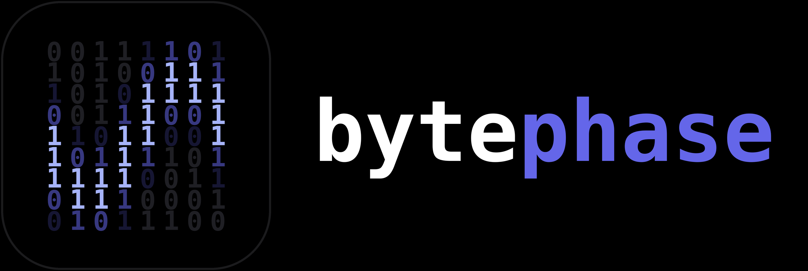

<div align="center">
  
  <h1>Bytephase</h1>
  <p><strong>Explore farther. Keep your bearings. Make the everyday easier.</strong></p>
  <p>A Fabric utility client for Minecraft, built for personal play on 2b2t.</p>
  <p><strong>0.1.0</strong> &nbsp;·&nbsp; Minecraft <strong>1.21.11</strong> &nbsp;·&nbsp; Fabric &nbsp;·&nbsp; MIT</p>
  <p>
    <a href="#features">Features</a> &nbsp;·&nbsp;
    <a href="#install">Install</a> &nbsp;·&nbsp;
    <a href="#build">Build</a> &nbsp;·&nbsp;
    <a href="docs/EXPLORATION.md">Exploration guide</a> &nbsp;·&nbsp;
    <a href="docs/MODULE_GUIDE.md">Module guide</a>
  </p>
</div>

---

## Features

A compact module system, a searchable ClickGUI and the matching binary `[01]`
HUD mark. Gameplay and exploration utilities sit alongside the existing ESP,
model effects, shaders and general visuals.

| For | Tools | What they do |
| --- | --- | --- |
| **Discovery** | `BaseFinder` · `SusChunks` | Scan loaded chunks for storage, utilities, spawners and amethyst candidates |
| **Navigation** | `Navigator` · `CoordSnapper` | Track saved waypoints and copy your position or a looked-at block |
| **Mining** | `TunnelMiner` · `PacketMine` · `MiningProgress` | Work a level tunnel with visible aim and view breaking progress |
| **Inventory & trade** | `HotbarArrange` · `TradeAssist` | Maintain configured hotbar roles and manually batch a selected merchant offer |
| **Profiles** | `/bytephase profile` | Save and load named module settings and enabled states |
| **Visuals & HUD** | ESP · Tracers · Nametags · StorageESP · SkyShaders | Entity and block overlays, model styles, sky presets and configurable HUD elements |
| **Combat & movement** | AutoCrystal · KillAura · Surround · Strafe · ElytraBounce | Configurable combat, protection and travel utilities |

Scanners use loaded terrain and report heuristics; findings are historical local
records. `HotbarArrange` defaults all nine roles to **Keep**. `TradeAssist`
starts from its bind with an offer selected in an open merchant screen.
Trading stops if explicit server inventory confirmation is unavailable.
See the [exploration guide](docs/EXPLORATION.md) for defaults and workflows.

## Install

1. Create a **Minecraft 1.21.11** installation with **Fabric Loader 0.20.1 or newer**.
2. Download [`bytephase-0.1.0.jar`](https://github.com/SeenOnSight/Bytephase/releases/download/v0.1.0/bytephase-0.1.0.jar)
   from [GitHub Releases](https://github.com/SeenOnSight/Bytephase/releases).
3. Put the Bytephase mod JAR and **Fabric API 0.141.6+1.21.11** in that
   installation's `mods/` directory.
4. Launch the Fabric profile with **Java 21 or newer** and press **Right Shift**.

Use the active launcher's game directory. To build the JAR from source,
use the instructions below.

## Build

Use **Java 25** for the configured Loom build. The mod itself targets
**Java 21** bytecode.

```sh
./gradlew build
```

Output: `build/libs/bytephase-0.1.0.jar`.

<details>
<summary><strong>Build versions</strong></summary>

| Component | Configured version |
| --- | --- |
| Bytephase | `0.1.0` |
| Minecraft | `1.21.11` |
| Yarn mappings | `1.21.11+build.6` |
| Fabric Loader | `0.20.1` |
| Fabric API | `0.141.6+1.21.11` |
| Fabric Loom | `1.19.2` |
| Gradle wrapper | `9.8.1` |
| Mod Java target | `21` |

Version sources: [gradle.properties](gradle.properties),
[build.gradle](build.gradle) and
[gradle-wrapper.properties](gradle/wrapper/gradle-wrapper.properties).

</details>

## Controls

| Action | Control |
| --- | --- |
| Open / close ClickGUI | **Right Shift**, or the configured ClickGUI key |
| Toggle a module | Left-click its row |
| Expand settings and bind | Click the row's chevron |
| Assign / clear a bind | Click **Bind**, then a key / **Escape** |
| Move / collapse a panel | Drag / right-click its header |
| Find a module | Type in the bottom search field |
| Open profiles | `/bytephase profile` |
| Show command help | `/bytephase` |

Sliders support dragging; mode values cycle with left/right click. Module binds
also appear in vanilla **Controls → Bytephase**. TradeAssist's bind works while
an open merchant screen has focus. More UI details and module-specific behavior
are in the [module guide](docs/MODULE_GUIDE.md).

## Your settings & places

| Path in the active game directory | Stores |
| --- | --- |
| `config/bytephase.json` | Module settings/states and ClickGUI layout |
| `config/bytephase/profiles/` | Named module snapshots |
| `config/bytephase/locations.json` | Server/dimension-scoped waypoints and findings |
| `options.txt` | Vanilla-managed keybinds |

Profiles contain module settings and states. Coordinates live in the location
store. See [local data](docs/EXPLORATION.md#local-data) for scope, limits and
backup details.

## Documentation

- [Exploration & everyday workflows](docs/EXPLORATION.md) — defaults, commands,
  discovery, navigation, mining, inventory, trading and profiles.
- [Module guide](docs/MODULE_GUIDE.md) — detailed controls and retained combat,
  movement, ESP, shader and HUD behavior notes.
- [Adding modules](docs/ADDING_MODULES.md) — module, setting and mixin structure.
- [Server compatibility](docs/SERVER_COMPATIBILITY.md) ·
  [Grim source audit](docs/GRIM_SOURCE_AUDIT.md) · [Audit notes](docs/AUDIT.md).

## License

[MIT](LICENSE) · Copyright © 2026 Bytephase contributors.
